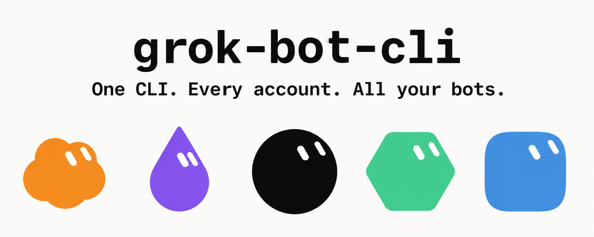
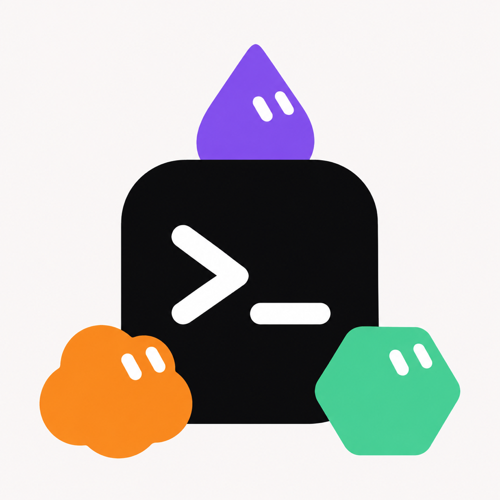
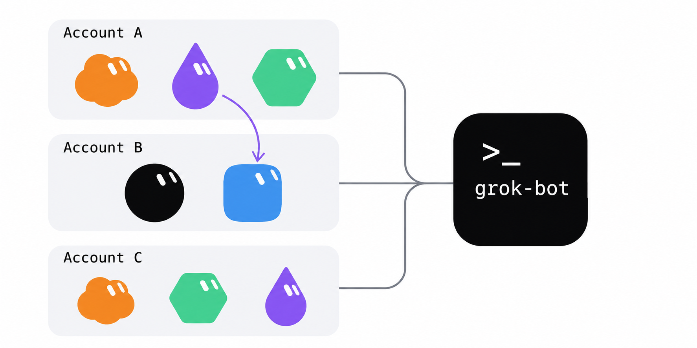

<p align="center">
  
</p>

<h1 align="center">
  
  <br />
  grok-bot
</h1>

<p align="center"><strong>Every account you log in. Every bot. One list.</strong></p>
<p align="center"><em>Multi-account roster · Cross-account relay · Any agent, through the skill · Bot, room, and skill management · One file on Node.js or Bun</em></p>

<p align="center">
  <a href="./README.md">English</a> ·
  <a href="./README_ZH.md">中文</a> ·
  <a href="./README_RU.md">Русский</a>
</p>

<p align="center">
  <a href="LICENSE"></a>
  <a href="https://github.com/RongleCat/grok-bot-cli/stargazers"></a>
  <a href="https://github.com/RongleCat/grok-bot-cli/releases"></a>
  <a href="https://github.com/RongleCat/grok-bot-cli/actions/workflows/ci.yml"></a>
  
  
  
</p>

<p align="center">
  <a href="https://x.com/cgnot996"></a>
  
</p>

<p align="center">
  
  &nbsp;&nbsp;
  
</p>

---

> [!NOTE]
> **About grok-bot:** This is an unofficial command line and agent skill for the Grok Bot desktop protocol (0.78.1). It is not an xAI product and not a Cursor product. Credentials stay on your machine. Every command runs as the account you logged in yourself.

---

## Contents

- [✨ Key Highlights](#highlights)
- [👥 Multi-Account](#multi-account)
- [🚀 Quick Start](#quick-start)
- [📖 Commands](#commands)
- [🤖 For Agents](#for-agents)
- [🔐 Security & Data Paths](#security)
- [⚠️ Known Limits](#limits)
- [💻 Development](#development)
- [🔗 Related Projects](#related)
- [🤝 Community & Contributing](#community)
- [📄 License & Author](#license)

---

<a id="highlights"></a>

## ✨ Key Highlights

- 👥 **Multi-Account, One Roster** — log in as many accounts as you want, every bot across all of them shows up in one list, address any of them as `account:bot`.
- 🔁 **Cross-account relay** — one shot from `alice:assistant` to `bob:reviewer`. The process exits when the handoff finishes. Nothing keeps forwarding after that.
- 🤖 **Any agent, through the skill** — Claude, or any other agent that can run a command and read JSON. Install the skill, then say 「初始化 grok-bot」.
- 🛠️ **Bot, room, and skill management** — create and edit in place. ⚠️ Destructive commands (`bot delete`, `room delete`, `room remove-member`, `room set-members`, `skill remove`) are a dry run until you pass `--yes`. A partial name is refused. There is no restore command.
- 📦 **One file, runtime stays outside** — the skill zip is about 74 KB. It runs on Node.js 22.13+ or Bun 1.1+. If neither is installed, the launcher installs Bun into your user directory. No administrator account.

---

<a id="multi-account"></a>

## 👥 Multi-Account

<p align="center">
  
</p>

An account is an alias you choose (`alice`, `bob`, `work`). It is 1–64 characters: a letter or digit, then letters, digits, `_`, or `-`. The alias `default` is the one used when you omit `--account`.

A bot ref is an id, a full name, a unique name fragment, or `alias:id-or-name` when that alias is registered. `alice:assistant` means the bot named `assistant` on the account `alice`.

Examples below are the launcher. From a clone that is `skills/grok-bot/scripts/grok-bot` (Windows: `skills\grok-bot\scripts\grok-bot.cmd`).

```bash
# 1. Start a browser login for a new alias.
grok-bot accounts add alice --start

# 2. After you approve the page. The default wait is 300 seconds.
grok-bot accounts add alice --wait

# 3. List aliases. --check calls getMe on each saved credential.
grok-bot accounts list --check

# 4. Every bot, on every registered account, in one list.
grok-bot bots --all-accounts

# 5. Send as the account that owns that bot, and wait for the reply.
grok-bot send --bot alice:assistant --text "Summarize the notes." --wait

# 6. Send the text to alice:assistant, wait, then forward that reply to bob:reviewer.
grok-bot relay --from alice:assistant --to bob:reviewer --text "Review this draft."

# 7. Commands that omit --account now use alice.
grok-bot accounts use alice

# 8. Remove bob from this machine. Bots and chats on that account are left as they are.
grok-bot accounts remove bob
```

`accounts add` takes the alias as a positional argument. Do not pass the new alias as `--account`. `--start` and `--wait` cannot be combined. Agents should add `--json --no-open` on `--start`, show `loginUrl` to the person, and use the same alias on `--wait`.

`accounts list --check` stays exit 0 when one account fails. The row carries `check.code`. `bots --all-accounts` stays exit 0 when at least one account succeeds. Failures remain on `accounts[].error`.

`relay --dry-run` resolves both bots and does not send. `--rounds` is an integer from 1 to 10. The default is 1, which is two sends: the text to `--from`, then the reply to `--to`.

Same person, second alias: exit 3, `ACCOUNT_ALREADY_ADDED`. `error.alias` is the alias already on this machine. The new credential is not kept.

Full flags: [skills/grok-bot/references/commands.md](skills/grok-bot/references/commands.md).

---

<a id="quick-start"></a>

## 🚀 Quick Start

Node.js 22.13+ or Bun 1.1+. You do not install a runtime yourself when the launcher can install Bun for you.

### 1. Install the skill

Download [tiezhu-grok-bot-skill.zip](https://github.com/RongleCat/grok-bot-cli/releases/latest/download/tiezhu-grok-bot-skill.zip). The archive root is `grok-bot/`. Unzip it into `~/.claude/skills/` (or the skills directory of another agent):

```bash
mkdir -p ~/.claude/skills
unzip tiezhu-grok-bot-skill.zip -d ~/.claude/skills
```

That leaves `~/.claude/skills/grok-bot/`. Tell the agent 「初始化 grok-bot」. The skill reads [skills/grok-bot/SKILL.md](skills/grok-bot/SKILL.md) and calls `scripts/grok-bot` inside that directory. It does not look up a different `grok-bot` on `PATH`.

### 2. Command line only

From this repository:

```bash
skills/grok-bot/scripts/grok-bot --version
```

Windows:

```bat
skills\grok-bot\scripts\grok-bot.cmd --version
```

Three lines, then you are on the right build:

```text
grok-bot 0.78.1
grok-bot-target 0.78.1
runtime node v22.20.0
```

The third line is `runtime bun vX.Y.Z` when Bun started the file.

Browser login is two steps, so a person can approve the page between them:

```bash
skills/grok-bot/scripts/grok-bot login --start --json --no-open
# open loginUrl in a browser and approve it, then:
skills/grok-bot/scripts/grok-bot login --wait --json --timeout 300
```

`--start` returns `loginUrl`, `expiresAt`, and `profile`. The default lifetime is 900 seconds. `--wait` defaults to 300 seconds. `--no-open` does not launch `open` (macOS), `xdg-open` (Linux), or `start` (Windows).

### Checksums

Each GitHub Release includes `SHA256SUMS.txt` for `tiezhu-grok-bot-skill.zip`. The skill also ships `skills/grok-bot/bin/SHA256SUMS` for `grok-bot.mjs`. The launcher checks that file before it runs.

```bash
# macOS / Linux — release archive
shasum -a 256 -c SHA256SUMS.txt

# macOS / Linux — the single-file CLI inside a clone or an unpacked skill
shasum -a 256 -c skills/grok-bot/bin/SHA256SUMS
```

```powershell
# Windows (PowerShell)
Get-FileHash .\tiezhu-grok-bot-skill.zip -Algorithm SHA256
Get-FileHash .\skills\grok-bot\bin\grok-bot.mjs -Algorithm SHA256
```

Compare the PowerShell hash with the hash in `SHA256SUMS.txt` or `skills\grok-bot\bin\SHA256SUMS`.

---

<a id="commands"></a>

## 📖 Commands

Global flags: `--json`, `--account <alias>`, `--profile <name>` (the same flag; they must match), `--help` / `-h`, `--version` / `-V`. With no account flag, the CLI uses the `default` alias in `accounts.json`.

A ref on `send`, `relay`, `watch`, `wait`, and the `bot`, `room`, and `skill` commands is searched across logged-in accounts when you do not pass `--account` and the ref has no account prefix. Several hits exit 3 with `AMBIGUOUS_BOT`. Pass `alias:name`.

| Group | Command | What it does |
| --- | --- | --- |
| Read | `status [--all-accounts]` | Login state for one account, or one row per account |
| Read | `accounts list [--check]` | Alias, masked label, default marker, credential presence |
| Read | `bots [--all-accounts]` | Bots on the selected account, or every registered account |
| Read | `sessions --bot <ref>` | Sessions for one bot |
| Read | `transcript --bot <ref> [--session <id>] [--limit <n>]` | Recent transcript. `--limit` is 1–500, default 20 |
| Read | `tasks --bot <ref> [--session <id>]` | Agent tasks and session tasks |
| Read | `todos --bot <ref>` | Agent todos |
| Read | `skills --bot <ref>` | Skills attached to the bot |
| Read | `files --bot <ref> [--page-token <token>]` | Read-only file list |
| Read | `invites --bot <ref>` | Read-only access invites |
| Read | `capabilities` | Runtime capability flags for the selected account |
| Read | `box` | Sandbox run state for the selected account |
| Send and wait | `send --bot <ref> --text <text> [--session <id>] [--file <path>...] [--wait] [--timeout <seconds>] [--idle-timeout <seconds>]` | Send with that bot's account. Repeat `--file` for attachments. `--timeout` and `--idle-timeout` require `--wait` |
| Send and wait | `wait --bot <ref> --message-id <id> [--session <id>] [--timeout <seconds>] [--idle-timeout <seconds>]` | Keep waiting for a message that was already accepted. This command does not send |
| Send and wait | `watch --bot <ref> [--bot <ref>...] [--session <id>]` | Stream events until the server closes the watch or you interrupt it. `--bot` may be repeated, including across accounts |
| Relay | `relay --from <ref> --to <ref> --text <text> [--template <text>] [--rounds <n>] [--timeout <seconds>] [--idle-timeout <seconds>] [--dry-run]` | One-shot handoff. Default template is `{reply}`. `--rounds` is 1–10, default 1 |
| Bot | `bot create --name <name> [--description <text>] [--title <text>]` | Create a bot on the selected account |
| Bot | `bot update --bot <ref> [--name <name>] [--description <text>] [--title <text>]` | Update name, description, or title. Sends `Bot.serverId` |
| Bot | `bot duplicate --bot <ref> [--name <name>]` | Copy the bot. Description and settings come along. Chat history and the avatar do not |
| Bot | ⚠️ `bot delete --bot <ref> [--yes]` | Dry run unless you pass `--yes` |
| Room | `room create --name <name> [--description <text>] --member <ref> [--member <ref>...]` | Create a room. Members must share one account |
| Room | `room add-member --room <ref> --user-id <id> [--user-id <id>...]` | Add human user ids. Each id is an integer from 1 to 2147483647 |
| Room | ⚠️ `room delete --room <ref> [--yes]` | Dry run unless you pass `--yes` |
| Room | ⚠️ `room remove-member --room <ref> --user-id <id>... [--yes]` | Dry run unless you pass `--yes` |
| Room | ⚠️ `room set-members --room <ref> --member <ref>... [--yes]` | Replaces bot members. Dry run unless you pass `--yes` |
| Skill | `skill add --bot <ref> --name <name> (--content <text> \| --content-file <path>) [--description <text>]` | Add one skill. Pass `--content` or `--content-file`, not both |
| Skill | `skill update --bot <ref> --name <name> (--content <text> \| --content-file <path>) [--description <text>]` | Replace one skill's text |
| Skill | ⚠️ `skill remove --bot <ref> --name <name> [--yes]` | Dry run unless you pass `--yes` |
| Accounts | `login [--start \| --wait] [--no-open] [--timeout <seconds>]` | Browser login for the selected account |
| Accounts | `logout` | Delete that account's credential and pending login. The registry row stays |
| Accounts | `accounts add <alias> [--start \| --wait] [--no-open] [--timeout <seconds>]` | Login, then register the alias |
| Accounts | `accounts use <alias>` | Make that alias the default |
| Accounts | `accounts rename <old> <new>` | Rename the registry row and the credential file |
| Accounts | `accounts remove <alias>` | Delete the local credential, the pending login, and the registry row |

⚠️ `bot delete`, `room delete`, `room remove-member`, `room set-members`, and `skill remove` print the target and write nothing until the same command is run again with `--yes`. A name fragment is `AMBIGUOUS_BOT` even when it matches one record. Pass an id or the full name. `accounts remove` does not use `--yes`. It only deletes local files.

`send --wait`, `wait`, and each `relay` step default to 600 seconds (maximum 3600) and an idle window of 2 seconds. On timeout after a send was accepted, continue with `wait`. Do not send the same text again.

Every flag and JSON field: [skills/grok-bot/references/commands.md](skills/grok-bot/references/commands.md).

---

<a id="for-agents"></a>

## 🤖 For Agents

The skill is a directory with a launcher, one JavaScript file, and a checksum. Read [skills/grok-bot/SKILL.md](skills/grok-bot/SKILL.md) before the first account command. Then read [skills/grok-bot/references/commands.md](skills/grok-bot/references/commands.md) for flags.

```bash
GROK_BOT="<skill directory>/scripts/grok-bot"
"$GROK_BOT" --version
```

On Windows the variable points at `scripts\grok-bot.cmd`.

Pass `--json` on every account command. Logs and progress stay on stderr. `watch --json` is one JSON object per line. Every other command writes one JSON object.

You cannot approve the login page, type a password, or click through the prompt. Show `loginUrl` and wait.

| Exit | Meaning |
| --- | --- |
| 0 | Success |
| 2 | Not logged in, or the credentials were rejected |
| 3 | Bad arguments, or the runtime is not supported (`RUNTIME_UNSUPPORTED`) |
| 4 | Network or server error |
| 5 | Timeout |

`error.exitCode` in the JSON is the same number. `send` and `relay` failures also include `error.sent`. `sent: true` means that message was accepted. Do not send it again. A failed `relay` includes `error.completedSteps` for the steps that already finished.

⚠️ On `bot delete`, `room delete`, `room remove-member`, `room set-members`, and `skill remove`, run once without `--yes`. Exit 0 and `"dryRun": true` means nothing was written. Show that JSON to the person. Add `--yes` only after they explicitly agree.

---

<a id="security"></a>

## 🔐 Security & Data Paths

Credentials are per alias. The default alias is `default`.

| OS | File |
| --- | --- |
| macOS | `~/Library/Application Support/grok-bot-cli/profiles/<alias>.json` |
| Linux | `${XDG_CONFIG_HOME:-~/.config}/grok-bot-cli/profiles/<alias>.json` |
| Windows | `%APPDATA%\grok-bot-cli\profiles\<alias>.json` |

The same directory holds `accounts.json` (aliases, a masked label, an identity hash) and `profiles/<alias>.pending.json` (the login verifier, while a login is in progress). `GROK_BOT_CONFIG_DIR` replaces that directory. `GROK_BOT_ACCESS_TOKEN` overrides the selected account's access token for this process only. It is not written to disk.

The CLI does not print access tokens, refresh tokens, verifiers, or raw identity ids. `--json` replaces secret-looking keys with `"[redacted]"`. There is no telemetry. Traffic is the account's own login and Grok Bot API.

The launcher checks `bin/grok-bot.mjs` against `bin/SHA256SUMS` before it starts. Releases publish `SHA256SUMS.txt` next to the zip.

There is no restore command. A delete that ran with `--yes` is final on the account.

Report a vulnerability through [GitHub Security Advisories](https://github.com/RongleCat/grok-bot-cli/security/advisories/new). Do not paste tokens into an issue. Details: [SECURITY.md](SECURITY.md).

---

<a id="limits"></a>

## ⚠️ Known Limits

- There is no command to edit a bot's instructions. `bot update` changes `--name`, `--description`, and `--title`.
- `bot duplicate` copies the description and settings. It does not copy chat history or the avatar.
- Windows is tested in CI (`windows-latest`, Node.js 22, plus a Bun `--version` smoke). The tests use mocked HTTP.
- The protocol target is Grok Bot 0.78.1, via [grok-bot-sdk 0.78.1](https://github.com/RongleCat/grok-bot-sdk). This is an unofficial interface. It can change.

---

<a id="development"></a>

## 💻 Development

```bash
npm install
npm test
npm run build
node scripts/check-skill-bin.mjs
node skills/grok-bot/bin/grok-bot.mjs --version
```

`npm test` does not contact a real account. `npm run build` writes `dist/grok-bot.mjs` and the same bytes to `skills/grok-bot/bin/grok-bot.mjs`, plus `SHA256SUMS` in both places. The bundle inlines `grok-bot-sdk`. The published file has no runtime dependency.

The SDK repository is [github.com/RongleCat/grok-bot-sdk](https://github.com/RongleCat/grok-bot-sdk).

Contributor notes: [CONTRIBUTING.md](CONTRIBUTING.md). Notes for agents that edit this repo: [AGENTS.md](AGENTS.md).

---

<a id="related"></a>

## 🔗 Related Projects

| Project | What it is |
| --- | --- |
| [grok-bot-sdk](https://github.com/RongleCat/grok-bot-sdk) | Unofficial SDK for the Grok Bot desktop protocol. This CLI bundles 0.78.1. |
| [grok-bot-clipper](https://github.com/RongleCat/grok-bot-clipper) | Browser extension that captures a page, a screenshot, or a post and sends it to your bots. |
| [awesome-grok-bot](https://github.com/RongleCat/awesome-grok-bot) | Curated list of Grok Bot resources. |
| [grok-app](https://github.com/RongleCat/grok-app) | Open-source desktop workbench for the local Grok Build CLI. |

---

<a id="community"></a>

## 🤝 Community & Contributing

Issues, pull requests, and notes on how the commands behave are welcome.

| Guide | Description |
| --- | --- |
| 📝 **Changelog** | [CHANGELOG.md](CHANGELOG.md) |
| 💡 **Contributing** | [CONTRIBUTING.md](CONTRIBUTING.md) |
| 🛡️ **Code of Conduct** | [CODE_OF_CONDUCT.md](CODE_OF_CONDUCT.md) |
| 🔒 **Security** | [SECURITY.md](SECURITY.md) |
| 🤖 **Agent notes for this repo** | [AGENTS.md](AGENTS.md) |

- X: [@cgnot996](https://x.com/cgnot996)
- Issues: https://github.com/RongleCat/grok-bot-cli/issues

---

<a id="license"></a>

## 📄 License & Author

This project is licensed under the [MIT License](LICENSE).

Copyright (c) 2026 RongleCat.

### Connect with the Author & Community

| Channel | Link |
| --- | --- |
| 𝕏 **X (Twitter)** | [@cgnot996 (铁柱AGI)](https://x.com/cgnot996) |
| 📢 **WeChat Official Account** | Search **「铁柱AGI」** or scan the QR above |
| 💬 **WeChat Community** | Scan the group QR above |
| 🐧 **Linux.do Community** | [linux.do](https://linux.do/) |

If grok-bot is useful on your machine, a star on the repository helps other people find it.
