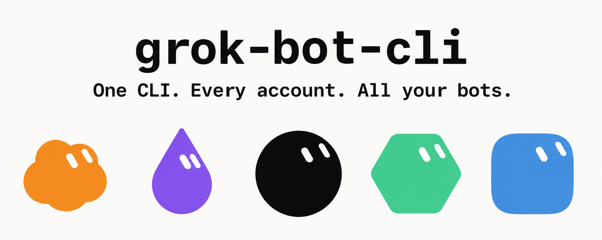
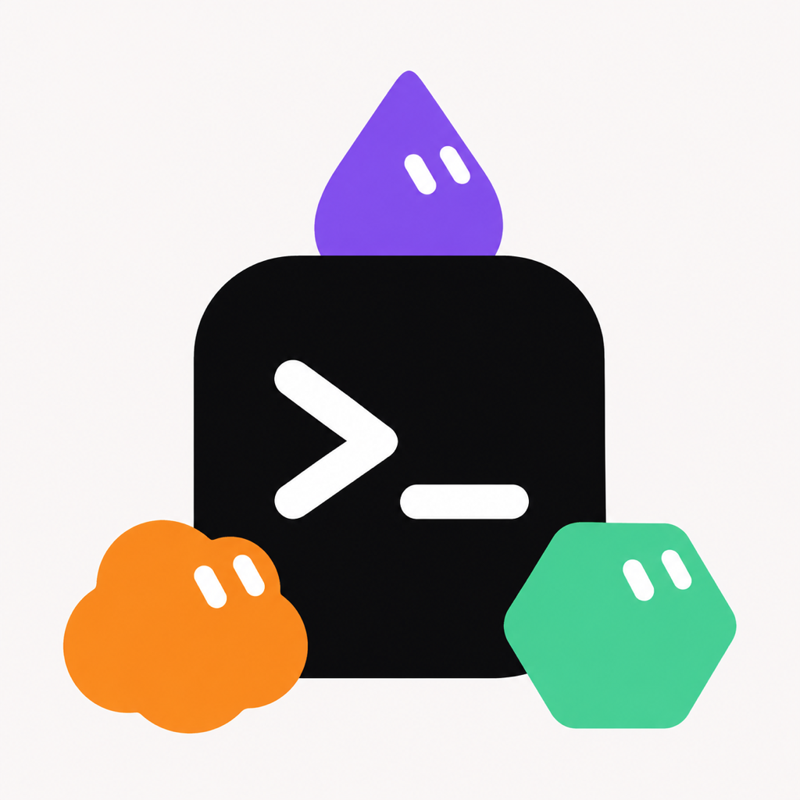
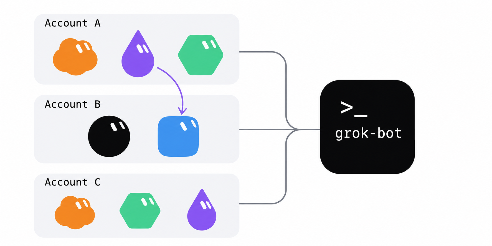

<p align="center">
  
</p>

<h1 align="center">
  
  <br />
  grok-bot
</h1>

<p align="center"><strong>Сколько угодно аккаунтов. Все боты. Один список.</strong></p>
<p align="center"><em>Общий список аккаунтов · Relay между аккаунтами · Любой агент через Skill · Боты, комнаты и Skill · Один файл на Node.js или Bun</em></p>

<p align="center">
  <a href="./README.md">English</a> ·
  <a href="./README_ZH.md">中文</a> ·
  <a href="./README_RU.md">Русский</a>
</p>

<p align="center">
  <a href="LICENSE"></a>
  <a href="https://github.com/RongleCat/grok-bot-cli/stargazers"></a>
  <a href="https://github.com/RongleCat/grok-bot-cli/releases"></a>
  <a href="https://github.com/RongleCat/grok-bot-cli/actions/workflows/ci.yml"></a>
  
  
  
</p>

<p align="center">
  <a href="https://x.com/cgnot996"></a>
  
</p>

<p align="center">
  
  &nbsp;&nbsp;
  
</p>

---

> [!NOTE]
> **О grok-bot.** Это неофициальная командная строка и Skill для агента под протокол Grok Bot 0.78.1. Это не продукт xAI и не продукт Cursor. Учётные данные остаются на вашем компьютере. Каждая команда идёт от аккаунта, в который вы вошли сами.

---

## Содержание

- [✨ Главное](#highlights)
- [👥 Несколько аккаунтов](#multi-account)
- [🚀 Быстрый старт](#quick-start)
- [📖 Команды](#commands)
- [🤖 Для агентов](#for-agents)
- [🔐 Безопасность и пути](#security)
- [⚠️ Известные ограничения](#limits)
- [💻 Разработка](#development)
- [🔗 Связанные проекты](#related)
- [🤝 Сообщество](#community)
- [📄 Лицензия и автор](#license)

---

<a id="highlights"></a>

## ✨ Главное

- 👥 **Несколько аккаунтов, один список** — входите в столько аккаунтов, сколько нужно. Все боты со всех аккаунтов попадают в один список. Обращение к любому из них: `account:bot`.
- 🔁 **Relay между аккаунтами** — одна передача от `alice:assistant` к `bob:reviewer`. Когда процесс завершился, ничего не продолжает пересылать.
- 🤖 **Любой агент через Skill** — Claude или другой агент, который умеет запускать команду и читать JSON. Установите Skill и скажите 「初始化 grok-bot」.
- 🛠️ **Боты, комнаты и Skill** — создание и правка выполняются сразу. ⚠️ Разрушительные команды (`bot delete`, `room delete`, `room remove-member`, `room set-members`, `skill remove`) по умолчанию только показывают цель. Запись идёт с `--yes`. Частичное имя отклоняется. Команды восстановления нет.
- 📦 **Один файл, среда снаружи** — zip Skill около 74 KB. Нужен Node.js 22.13+ или Bun 1.1+. Если нет ни того ни другого, лаунчер ставит Bun в каталог пользователя. Права администратора не нужны.

---

<a id="multi-account"></a>

## 👥 Несколько аккаунтов

<p align="center">
  
</p>

Аккаунт — это псевдоним, который выбираете вы (`alice`, `bob`, `work`). От 1 до 64 символов: первая буква или цифра, дальше буквы, цифры, `_` или `-`. Если `--account` не указан, используется псевдоним `default`.

Ссылка на бота — это id, полное имя, уникальный фрагмент имени или `псевдоним:id-или-имя`, если псевдоним зарегистрирован. `alice:assistant` — бот с именем `assistant` на аккаунте `alice`.

Ниже `grok-bot` — это лаунчер. В клоне репозитория на macOS и Linux: `skills/grok-bot/scripts/grok-bot`. В Windows: `skills\grok-bot\scripts\grok-bot.cmd`.

```bash
# 1. Начать вход в браузере для нового псевдонима.
grok-bot accounts add alice --start

# 2. После подтверждения страницы. Ожидание по умолчанию — 300 секунд.
grok-bot accounts add alice --wait

# 3. Список псевдонимов. --check вызывает getMe для каждого сохранённого входа.
grok-bot accounts list --check

# 4. Все боты всех зарегистрированных аккаунтов одним списком.
grok-bot bots --all-accounts

# 5. Отправить от аккаунта, которому принадлежит бот, и дождаться ответа.
grok-bot send --bot alice:assistant --text "Summarize the notes." --wait

# 6. Отправить текст боту alice:assistant, дождаться ответа и переслать его bob:reviewer.
grok-bot relay --from alice:assistant --to bob:reviewer --text "Review this draft."

# 7. Команды без --account дальше идут от alice.
grok-bot accounts use alice

# 8. Убрать bob с этого компьютера. Боты и переписки аккаунта не трогаются.
grok-bot accounts remove bob
```

У `accounts add` псевдоним — позиционный аргумент. Не передавайте его как `--account`. `--start` и `--wait` нельзя совмещать в одном вызове. Агенту нужно добавить `--json --no-open` к `--start`, показать человеку `loginUrl` и вызвать `--wait` с тем же псевдонимом.

`accounts list --check` остаётся с кодом 0, даже если одна проверка не удалась. Код лежит в `check.code` этой строки. `bots --all-accounts` остаётся с кодом 0, если хотя бы один аккаунт ответил. Ошибки остаются в `accounts[].error`.

`relay --dry-run` находит обоих ботов и ничего не отправляет. `--rounds` — целое от 1 до 10, по умолчанию 1. Это две отправки: текст в `--from`, затем ответ в `--to`.

Тот же человек под вторым псевдонимом: код 3, `ACCOUNT_ALREADY_ADDED`. `error.alias` — псевдоним, который уже есть на этой машине. Новый файл входа не сохраняется.

Все флаги: [skills/grok-bot/references/commands.md](skills/grok-bot/references/commands.md).

---

<a id="quick-start"></a>

## 🚀 Быстрый старт

Нужен Node.js 22.13+ или Bun 1.1+. Отдельно ставить среду не нужно, если лаунчер может поставить Bun сам.

### 1. Установить Skill

Скачайте [tiezhu-grok-bot-skill.zip](https://github.com/RongleCat/grok-bot-cli/releases/latest/download/tiezhu-grok-bot-skill.zip). Корень архива — `grok-bot/`. Распакуйте в `~/.claude/skills/` или в каталог skills другого агента:

```bash
mkdir -p ~/.claude/skills
unzip tiezhu-grok-bot-skill.zip -d ~/.claude/skills
```

Получится `~/.claude/skills/grok-bot/`. Скажите агенту 「初始化 grok-bot」. Он читает [skills/grok-bot/SKILL.md](skills/grok-bot/SKILL.md) и вызывает `scripts/grok-bot` внутри этого каталога. Другой `grok-bot` из `PATH` он не берёт.

### 2. Только командная строка

Из этого репозитория:

```bash
skills/grok-bot/scripts/grok-bot --version
```

Windows:

```bat
skills\grok-bot\scripts\grok-bot.cmd --version
```

Три строки — нужная сборка:

```text
grok-bot 0.3.0
grok-bot-target 0.78.1
runtime node v22.20.0
```

Если файл запустил Bun, третья строка: `runtime bun vX.Y.Z`.

Вход в браузере — два шага, чтобы человек успел подтвердить страницу:

```bash
skills/grok-bot/scripts/grok-bot login --start --json --no-open
# откройте loginUrl в браузере и подтвердите, затем:
skills/grok-bot/scripts/grok-bot login --wait --json --timeout 300
```

`--start` возвращает `loginUrl`, `expiresAt` и `profile`. Срок по умолчанию — 900 секунд. `--wait` ждёт 300 секунд. `--no-open` не вызывает `open` (macOS), `xdg-open` (Linux) и `start` (Windows).

### Контрольные суммы

В каждом GitHub Release есть `SHA256SUMS.txt` для `tiezhu-grok-bot-skill.zip`. В Skill также лежит `skills/grok-bot/bin/SHA256SUMS` для `grok-bot.mjs`. Лаунчер сверяет этот файл перед запуском.

```bash
# macOS / Linux — архив релиза
shasum -a 256 -c SHA256SUMS.txt

# macOS / Linux — один файл в клоне или распакованном Skill
shasum -a 256 -c skills/grok-bot/bin/SHA256SUMS
```

```powershell
# Windows (PowerShell)
Get-FileHash .\tiezhu-grok-bot-skill.zip -Algorithm SHA256
Get-FileHash .\skills\grok-bot\bin\grok-bot.mjs -Algorithm SHA256
```

Сверьте хеш PowerShell со строкой в `SHA256SUMS.txt` или `skills\grok-bot\bin\SHA256SUMS`.

---

<a id="commands"></a>

## 📖 Команды

Общие флаги: `--json`, `--account <alias>`, `--profile <name>` (тот же флаг; если заданы оба, значения должны совпасть), `--help` / `-h`, `--version` / `-V`. Без флага аккаунта CLI берёт псевдоним `default` из `accounts.json`.

Для `send`, `relay`, `watch`, `wait` и подкоманд `bot`, `room`, `skill` поиск идёт по всем вошедшим аккаунтам, если нет `--account` и в ссылке нет префикса аккаунта. Несколько совпадений — код 3, `AMBIGUOUS_BOT`. Передайте `alias:name`.

| Группа | Команда | Что делает |
| --- | --- | --- |
| Чтение | `status [--all-accounts]` | Состояние входа одного аккаунта или строка на каждый |
| Чтение | `accounts list [--check]` | Псевдоним, маска почты, признак по умолчанию, наличие входа |
| Чтение | `bots [--all-accounts]` | Боты выбранного аккаунта или всех зарегистрированных |
| Чтение | `sessions --bot <ref>` | Сессии одного бота |
| Чтение | `transcript --bot <ref> [--session <id>] [--limit <n>]` | Последние записи. `--limit` от 1 до 500, по умолчанию 20 |
| Чтение | `tasks --bot <ref> [--session <id>]` | Задачи агента и задачи сессии |
| Чтение | `todos --bot <ref>` | Задачи агента |
| Чтение | `skills --bot <ref>` | Skill, прикреплённые к боту |
| Чтение | `files --bot <ref> [--page-token <token>]` | Только чтение, список файлов |
| Чтение | `invites --bot <ref>` | Только чтение, приглашения |
| Чтение | `capabilities` | Флаги возможностей выбранного аккаунта |
| Чтение | `box` | Состояние песочницы выбранного аккаунта |
| Отправка и ожидание | `send --bot <ref> --text <text> [--session <id>] [--file <path>...] [--wait] [--timeout <seconds>] [--idle-timeout <seconds>]` | Отправка от аккаунта этого бота. `--file` повторяется. `--timeout` и `--idle-timeout` только вместе с `--wait` |
| Отправка и ожидание | `wait --bot <ref> --message-id <id> [--session <id>] [--timeout <seconds>] [--idle-timeout <seconds>]` | Продолжить ожидание уже принятого сообщения. Повторно не отправляет |
| Отправка и ожидание | `watch --bot <ref> [--bot <ref>...] [--session <id>]` | Поток событий, пока сервер не закроет его или вы не прервёте процесс. `--bot` можно повторять, в том числе с разных аккаунтов |
| Relay | `relay --from <ref> --to <ref> --text <text> [--template <text>] [--rounds <n>] [--timeout <seconds>] [--idle-timeout <seconds>] [--dry-run]` | Одна передача. Шаблон по умолчанию `{reply}`. `--rounds` от 1 до 10, по умолчанию 1 |
| Бот | `bot create --name <name> [--description <text>] [--title <text>]` | Создать бота на выбранном аккаунте |
| Бот | `bot update --bot <ref> [--name <name>] [--description <text>] [--title <text>]` | Имя, описание или заголовок. Уходит `Bot.serverId` |
| Бот | `bot duplicate --bot <ref> [--name <name>]` | Копия бота. Описание и настройки переносятся. История чата и аватар — нет |
| Бот | ⚠️ `bot delete --bot <ref> [--yes]` | Без `--yes` только показ цели |
| Комната | `room create --name <name> [--description <text>] --member <ref> [--member <ref>...]` | Создать комнату. Участники должны быть на одном аккаунте |
| Комната | `room add-member --room <ref> --user-id <id> [--user-id <id>...]` | Добавить id людей. Целое от 1 до 2147483647 |
| Комната | ⚠️ `room delete --room <ref> [--yes]` | Без `--yes` только показ цели |
| Комната | ⚠️ `room remove-member --room <ref> --user-id <id>... [--yes]` | Без `--yes` только показ цели |
| Комната | ⚠️ `room set-members --room <ref> --member <ref>... [--yes]` | Заменяет ботов-участников. Без `--yes` только показ цели |
| Skill | `skill add --bot <ref> --name <name> (--content <text> \| --content-file <path>) [--description <text>]` | Добавить один Skill. Либо `--content`, либо `--content-file` |
| Skill | `skill update --bot <ref> --name <name> (--content <text> \| --content-file <path>) [--description <text>]` | Заменить текст одного Skill |
| Skill | ⚠️ `skill remove --bot <ref> --name <name> [--yes]` | Без `--yes` только показ цели |
| Аккаунты | `login [--start \| --wait] [--no-open] [--timeout <seconds>]` | Вход в браузере для выбранного аккаунта |
| Аккаунты | `logout` | Удалить вход и незавершённый логин. Строка в реестре остаётся |
| Аккаунты | `accounts add <alias> [--start \| --wait] [--no-open] [--timeout <seconds>]` | Войти и зарегистрировать псевдоним |
| Аккаунты | `accounts use <alias>` | Сделать псевдоним аккаунтом по умолчанию |
| Аккаунты | `accounts rename <old> <new>` | Переименовать строку реестра и файл входа |
| Аккаунты | `accounts remove <alias>` | Удалить локальный вход, незавершённый логин и строку реестра |

⚠️ `bot delete`, `room delete`, `room remove-member`, `room set-members` и `skill remove` без `--yes` печатают цель и ничего не записывают. Та же команда с `--yes` выполняет действие. Фрагмент имени даёт `AMBIGUOUS_BOT`, даже если совпадение одно. Передайте id или полное имя. `accounts remove` не использует `--yes`. Команда удаляет только локальные файлы.

`send --wait`, `wait` и каждый шаг `relay` ждут по умолчанию 600 секунд (максимум 3600) с окном простоя 2 секунды. Если отправка уже принята и время вышло, продолжайте через `wait`. Тот же текст повторно не отправляйте.

Каждый флаг и поле JSON: [skills/grok-bot/references/commands.md](skills/grok-bot/references/commands.md).

---

<a id="for-agents"></a>

## 🤖 Для агентов

Skill — это каталог: лаунчер, один файл JavaScript и контрольная сумма. Перед первой командой к аккаунту прочитайте [skills/grok-bot/SKILL.md](skills/grok-bot/SKILL.md). Флаги — в [skills/grok-bot/references/commands.md](skills/grok-bot/references/commands.md).

```bash
GROK_BOT="<skill directory>/scripts/grok-bot"
"$GROK_BOT" --version
```

В Windows переменная указывает на `scripts\grok-bot.cmd`.

На каждую команду аккаунта добавляйте `--json`. Журнал и прогресс остаются в stderr. `watch --json` пишет один объект JSON на строку. Остальные команды пишут один объект.

Нельзя подтверждать страницу входа, вводить пароль или нажимать кнопки за человека. Покажите `loginUrl` и ждите.

| Код | Значение |
| --- | --- |
| 0 | Успех |
| 2 | Нет входа, или учётные данные отклонены |
| 3 | Неверные аргументы, или среда не поддерживается (`RUNTIME_UNSUPPORTED`) |
| 4 | Сеть или ошибка сервера |
| 5 | Таймаут |

`error.exitCode` в JSON — то же число. У ошибок `send` и `relay` есть `error.sent`. `sent: true` значит, что сообщение уже принято. Не отправляйте его снова. У неудачного `relay` есть `error.completedSteps` — шаги, которые уже завершились.

⚠️ Для `bot delete`, `room delete`, `room remove-member`, `room set-members` и `skill remove` сначала запустите команду без `--yes`. Код 0 и `"dryRun": true` значат, что записи не было. Покажите этот JSON человеку. `--yes` добавляйте только после явного согласия.

---

<a id="security"></a>

## 🔐 Безопасность и пути

Вход хранится отдельно для каждого псевдонима. Псевдоним по умолчанию — `default`.

| ОС | Файл |
| --- | --- |
| macOS | `~/Library/Application Support/grok-bot-cli/profiles/<alias>.json` |
| Linux | `${XDG_CONFIG_HOME:-~/.config}/grok-bot-cli/profiles/<alias>.json` |
| Windows | `%APPDATA%\grok-bot-cli\profiles\<alias>.json` |

В том же каталоге лежат `accounts.json` (псевдонимы, маска почты, хеш личности) и `profiles/<alias>.pending.json` (verifier, пока вход не закончен). `GROK_BOT_CONFIG_DIR` заменяет этот каталог. `GROK_BOT_ACCESS_TOKEN` подменяет access token только выбранного аккаунта и только в этом процессе. На диск он не пишется.

CLI не печатает access token, refresh token, verifier и сырой id личности. В `--json` поля, похожие на секрет, заменяются на `"[redacted]"`. Телеметрии нет. Трафик — это вход вашего аккаунта и API Grok Bot.

Лаунчер сверяет `bin/grok-bot.mjs` с `bin/SHA256SUMS` перед запуском. Рядом с zip релиза публикуется `SHA256SUMS.txt`.

Команды восстановления нет. Удаление с `--yes` на аккаунте окончательно.

Уязвимость сообщайте через [GitHub Security Advisories](https://github.com/RongleCat/grok-bot-cli/security/advisories/new). Не вставляйте токены в issue. Подробности: [SECURITY.md](SECURITY.md).

---

<a id="limits"></a>

## ⚠️ Известные ограничения

- Нет команды, которая меняет инструкции бота. `bot update` меняет `--name`, `--description` и `--title`.
- `bot duplicate` копирует описание и настройки. История чата и аватар не копируются.
- Windows проверяется в CI (`windows-latest`, Node.js 22 и дымовой `--version` на Bun). Тесты ходят в поддельный HTTP.
- Цель протокола — Grok Bot 0.78.1 через [grok-bot-sdk 0.78.1](https://github.com/RongleCat/grok-bot-sdk). Интерфейс неофициальный и может измениться.

---

<a id="development"></a>

## 💻 Разработка

```bash
npm install
npm test
npm run build
node scripts/check-skill-bin.mjs
node skills/grok-bot/bin/grok-bot.mjs --version
```

`npm test` не обращается к настоящему аккаунту. `npm run build` пишет `dist/grok-bot.mjs` и те же байты в `skills/grok-bot/bin/grok-bot.mjs`, плюс `SHA256SUMS` в обоих местах. В файл встраивается `grok-bot-sdk`. У опубликованного файла нет зависимости на время запуска.

Репозиторий SDK: [github.com/RongleCat/grok-bot-sdk](https://github.com/RongleCat/grok-bot-sdk).

Заметки для людей: [CONTRIBUTING.md](CONTRIBUTING.md). Заметки для агента, который правит этот репозиторий: [AGENTS.md](AGENTS.md).

---

<a id="related"></a>

## 🔗 Связанные проекты

| Проект | Что это |
| --- | --- |
| [grok-bot-sdk](https://github.com/RongleCat/grok-bot-sdk) | Неофициальный SDK протокола Grok Bot. Этот CLI встраивает 0.78.1. |
| [grok-bot-clipper](https://github.com/RongleCat/grok-bot-clipper) | Расширение браузера: страница, скриншот или пост уходят вашим ботам. |
| [awesome-grok-bot](https://github.com/RongleCat/awesome-grok-bot) | Подборка материалов по Grok Bot. |
| [grok-app](https://github.com/RongleCat/grok-app) | Открытый настольный верстак для локального Grok Build CLI. |

---

<a id="community"></a>

## 🤝 Сообщество

Issue, pull request и замечания о том, как команды ведут себя на деле, приветствуются.

| Документ | О чём |
| --- | --- |
| 📝 **Журнал изменений** | [CHANGELOG.md](CHANGELOG.md) |
| 💡 **Участие** | [CONTRIBUTING.md](CONTRIBUTING.md) |
| 🛡️ **Нормы поведения** | [CODE_OF_CONDUCT.md](CODE_OF_CONDUCT.md) |
| 🔒 **Безопасность** | [SECURITY.md](SECURITY.md) |
| 🤖 **Заметки агенту по репозиторию** | [AGENTS.md](AGENTS.md) |

- X: [@cgnot996](https://x.com/cgnot996)
- Issues: https://github.com/RongleCat/grok-bot-cli/issues

---

<a id="license"></a>

## 📄 Лицензия и автор

Проект под [лицензией MIT](LICENSE).

Copyright (c) 2026 RongleCat.

### Автор и сообщество

| Канал | Ссылка |
| --- | --- |
| 𝕏 **X (Twitter)** | [@cgnot996 (铁柱AGI)](https://x.com/cgnot996) |
| 📢 **Официальный аккаунт WeChat** | Найдите **「铁柱AGI」** или отсканируйте QR выше |
| 💬 **Сообщество WeChat** | Отсканируйте QR группы выше |
| 🐧 **Сообщество Linux.do** | [linux.do](https://linux.do/) |

Если grok-bot пригодился, звезда репозитория поможет другим его найти.
