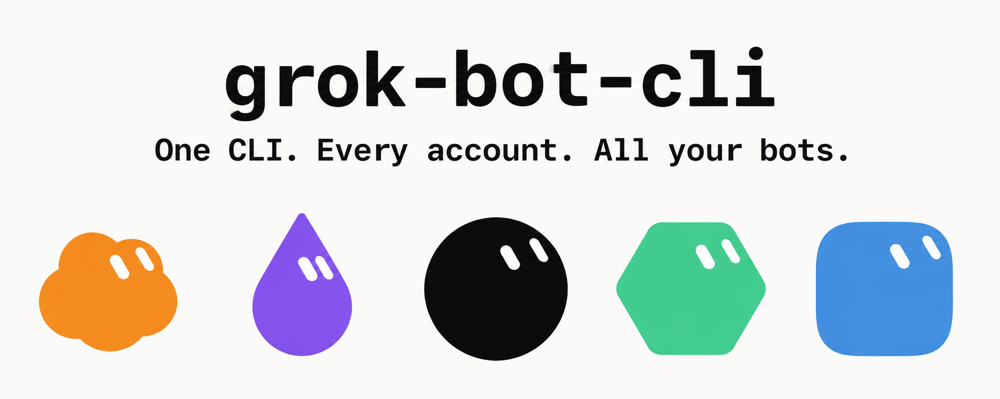
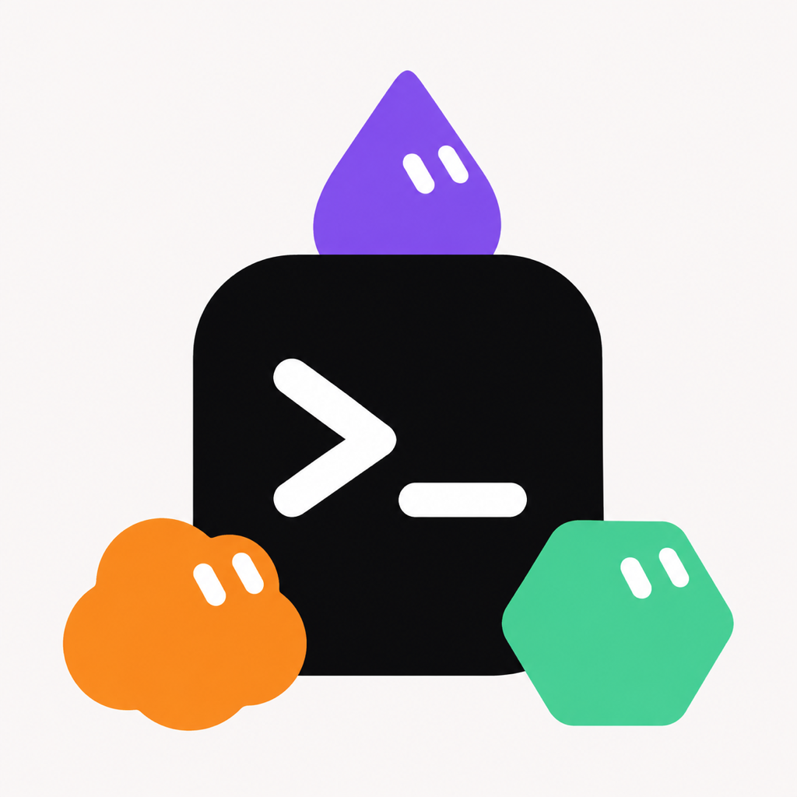
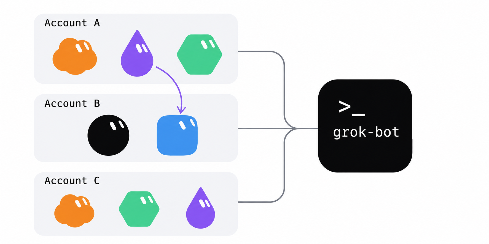

<p align="center">
  
</p>

<h1 align="center">
  
  <br />
  grok-bot
</h1>

<p align="center"><strong>登多少个账号都行。所有 bot，一张总表。</strong></p>
<p align="center"><em>多账号名册 · 跨账号 relay · 任何 Agent 用 Skill 调用 · Bot、群组、Skill 管理 · 一个文件，运行时用本机的 Node.js 或 Bun</em></p>

<p align="center">
  <a href="./README.md">English</a> ·
  <a href="./README_ZH.md">中文</a> ·
  <a href="./README_RU.md">Русский</a>
</p>

<p align="center">
  <a href="LICENSE"></a>
  <a href="https://github.com/RongleCat/grok-bot-cli/stargazers"></a>
  <a href="https://github.com/RongleCat/grok-bot-cli/releases"></a>
  <a href="https://github.com/RongleCat/grok-bot-cli/actions/workflows/ci.yml"></a>
  
  
  
</p>

<p align="center">
  <a href="https://x.com/cgnot996"></a>
  
</p>

<p align="center">
  
  &nbsp;&nbsp;
  
</p>

---

> [!NOTE]
> **关于 grok-bot：** 这是给 Grok Bot 桌面协议（0.78.1）用的非官方命令行和 Agent Skill。它不是 xAI 的产品，也不是 Cursor 的产品。凭证只存在你这台机器上。每条命令都走你自己登录的账号。

---

## 目录

- [✨ 先看这几件事](#highlights)
- [👥 多账号](#multi-account)
- [🚀 快速开始](#quick-start)
- [📖 命令](#commands)
- [🤖 给 Agent](#for-agents)
- [🔐 安全与数据目录](#security)
- [⚠️ 已知限制](#limits)
- [💻 开发](#development)
- [🔗 相关项目](#related)
- [🤝 社区与贡献](#community)
- [📄 许可与作者](#license)

---

<a id="highlights"></a>

## ✨ 先看这几件事

- 👥 **多账号，一张总表** — 想登几个账号就登几个。所有账号下的 bot 出现在同一张列表里。要找其中某一个，写成 `account:bot`。
- 🔁 **跨账号 relay** — 从 `alice:assistant` 交给 `bob:reviewer`，一次做完。进程退出后不会有东西继续转发。
- 🤖 **任何 Agent 都能用** — Claude，或者任何一个会跑命令、会读 JSON 的 Agent。装上 Skill，对它说「初始化 grok-bot」。
- 🛠️ **Bot、群组、Skill 都能管** — 创建和修改直接做。⚠️ 删 bot、删群、踢成员、覆盖成员、删 Skill（`bot delete`、`room delete`、`room remove-member`、`room set-members`、`skill remove`）默认只演练，加上 `--yes` 才真的写。名字只写一半会被拒绝。没有恢复接口。
- 📦 **一个文件，运行时在外面** — Skill 的 zip 大约 74 KB。Node.js 22.13+ 或 Bun 1.1+ 都能跑。两个都没有时，启动器把 Bun 装进你的用户目录，不需要管理员。

---

<a id="multi-account"></a>

## 👥 多账号

<p align="center">
  
</p>

账号就是你起的别名（`alice`、`bob`、`work`）。1 到 64 位：开头是字母或数字，后面可以是字母、数字、`_` 或 `-`。不写 `--account` 时，用的是别名 `default`。

bot 的引用可以是 id、完整名字、唯一的名字片段，或者已登记别名上的 `别名:id或名字`。`alice:assistant` 就是账号 `alice` 上叫 `assistant` 的那个 bot。

下面的 `grok-bot` 指启动器。克隆本仓库后，macOS 和 Linux 是 `skills/grok-bot/scripts/grok-bot`，Windows 是 `skills\grok-bot\scripts\grok-bot.cmd`。

```bash
# 1. 给一个新别名开始浏览器登录。
grok-bot accounts add alice --start

# 2. 你在页面上点了同意之后。默认等 300 秒。
grok-bot accounts add alice --wait

# 3. 列出别名。--check 会对每个已保存的凭证调用 getMe。
grok-bot accounts list --check

# 4. 所有已登记账号上的 bot，一次列出来。
grok-bot bots --all-accounts

# 5. 用这个 bot 所属账号的凭证发消息，并等到回复。
grok-bot send --bot alice:assistant --text "Summarize the notes." --wait

# 6. 把这段文字发给 alice:assistant，等它回完，再把回复转给 bob:reviewer。
grok-bot relay --from alice:assistant --to bob:reviewer --text "Review this draft."

# 7. 之后不写 --account 的命令，默认走 alice。
grok-bot accounts use alice

# 8. 从这台机器上拿掉 bob。账号里的 bot 和聊天记录不动。
grok-bot accounts remove bob
```

`accounts add` 的别名是位置参数，不要写成 `--account`。`--start` 和 `--wait` 不能写在同一次调用里。Agent 应在 `--start` 上加 `--json --no-open`，把 `loginUrl` 交给人去打开，`--wait` 用同一个别名。

`accounts list --check` 里某一个账号失败，整条命令仍是退出码 0，失败写在这一行的 `check.code`。`bots --all-accounts` 只要有一个账号成功就是退出码 0，失败留在 `accounts[].error`。

`relay --dry-run` 只解析两端 bot，不发送。`--rounds` 是 1 到 10 的整数，默认 1。默认就是两步发送：原文给 `--from`，回复再给 `--to`。

同一个人再登到另一个别名上：退出码 3，`ACCOUNT_ALREADY_ADDED`。`error.alias` 是这台机器上已有的别名。新凭证不会留下。

每个参数见 [skills/grok-bot/references/commands.md](skills/grok-bot/references/commands.md)。

---

<a id="quick-start"></a>

## 🚀 快速开始

需要 Node.js 22.13+ 或 Bun 1.1+。启动器能自己装 Bun 时，你不用先去装运行时。

### 1. 装 Skill

下载 [tiezhu-grok-bot-skill.zip](https://github.com/RongleCat/grok-bot-cli/releases/latest/download/tiezhu-grok-bot-skill.zip)。压缩包根目录是 `grok-bot/`。解压到 `~/.claude/skills/`，或者其他 Agent 的 skills 目录：

```bash
mkdir -p ~/.claude/skills
unzip tiezhu-grok-bot-skill.zip -d ~/.claude/skills
```

得到 `~/.claude/skills/grok-bot/`。对 Agent 说「初始化 grok-bot」。它读的是 [skills/grok-bot/SKILL.md](skills/grok-bot/SKILL.md)，调用的是该目录里的 `scripts/grok-bot`，不会去 `PATH` 上随便找一个同名命令。

### 2. 只用命令行

在本仓库里：

```bash
skills/grok-bot/scripts/grok-bot --version
```

Windows：

```bat
skills\grok-bot\scripts\grok-bot.cmd --version
```

三行对上，就是这一版：

```text
grok-bot 0.3.0
grok-bot-target 0.78.1
runtime node v22.20.0
```

如果是 Bun 启动的，第三行是 `runtime bun vX.Y.Z`。

浏览器登录拆成两步，方便人在中间去点同意：

```bash
skills/grok-bot/scripts/grok-bot login --start --json --no-open
# 浏览器打开 loginUrl 并同意之后：
skills/grok-bot/scripts/grok-bot login --wait --json --timeout 300
```

`--start` 返回 `loginUrl`、`expiresAt`、`profile`。默认有效期 900 秒。`--wait` 默认 300 秒。`--no-open` 不会去调 macOS 的 `open`、Linux 的 `xdg-open`、Windows 的 `start`。

### 校验和

每次 GitHub Release 都带 `SHA256SUMS.txt`，对应 `tiezhu-grok-bot-skill.zip`。Skill 里还有 `skills/grok-bot/bin/SHA256SUMS`，对应 `grok-bot.mjs`。启动器在运行前会核对这个文件。

```bash
# macOS / Linux — 发布包
shasum -a 256 -c SHA256SUMS.txt

# macOS / Linux — 仓库或解压后的单文件
shasum -a 256 -c skills/grok-bot/bin/SHA256SUMS
```

```powershell
# Windows (PowerShell)
Get-FileHash .\tiezhu-grok-bot-skill.zip -Algorithm SHA256
Get-FileHash .\skills\grok-bot\bin\grok-bot.mjs -Algorithm SHA256
```

把 PowerShell 打出来的哈希和 `SHA256SUMS.txt` 或 `skills\grok-bot\bin\SHA256SUMS` 里的那一行对一下。

---

<a id="commands"></a>

## 📖 命令

全局参数：`--json`、`--account <alias>`、`--profile <name>`（同一个参数，两个都写就必须一致）、`--help` / `-h`、`--version` / `-V`。不指定账号时，用 `accounts.json` 里的 `default`。

`send`、`relay`、`watch`、`wait`，以及 `bot`、`room`、`skill` 的子命令：没写 `--account`、引用里也没有账号前缀时，会在所有已登录账号里找。找到多个就退出码 3，`AMBIGUOUS_BOT`。这时改成 `别名:名字`。

| 分组 | 命令 | 作用 |
| --- | --- | --- |
| 读 | `status [--all-accounts]` | 一个账号的登录状态，或每个账号一行 |
| 读 | `accounts list [--check]` | 别名、打码后的邮箱、是否默认、凭证在不在 |
| 读 | `bots [--all-accounts]` | 当前账号的 bot，或所有已登记账号的 bot |
| 读 | `sessions --bot <ref>` | 某个 bot 的会话 |
| 读 | `transcript --bot <ref> [--session <id>] [--limit <n>]` | 最近的对话。`--limit` 为 1–500，默认 20 |
| 读 | `tasks --bot <ref> [--session <id>]` | Agent 任务和会话任务 |
| 读 | `todos --bot <ref>` | Agent 待办 |
| 读 | `skills --bot <ref>` | 这个 bot 上的 Skill |
| 读 | `files --bot <ref> [--page-token <token>]` | 只读，列出文件 |
| 读 | `invites --bot <ref>` | 只读，列出访问邀请 |
| 读 | `capabilities` | 当前账号的运行时能力开关 |
| 读 | `box` | 当前账号的沙箱状态 |
| 发送与等待 | `send --bot <ref> --text <text> [--session <id>] [--file <path>...] [--wait] [--timeout <seconds>] [--idle-timeout <seconds>]` | 用这个 bot 所属账号发送。`--file` 可重复。`--timeout` 和 `--idle-timeout` 必须和 `--wait` 一起用 |
| 发送与等待 | `wait --bot <ref> --message-id <id> [--session <id>] [--timeout <seconds>] [--idle-timeout <seconds>]` | 对已经接受的消息继续等。这条命令不会再发 |
| 发送与等待 | `watch --bot <ref> [--bot <ref>...] [--session <id>]` | 持续输出事件，直到服务端关掉或你打断。`--bot` 可以重复，也可以跨账号 |
| relay | `relay --from <ref> --to <ref> --text <text> [--template <text>] [--rounds <n>] [--timeout <seconds>] [--idle-timeout <seconds>] [--dry-run]` | 一次性转交。默认模板是 `{reply}`。`--rounds` 为 1–10，默认 1 |
| Bot | `bot create --name <name> [--description <text>] [--title <text>]` | 在当前选中的账号上创建 bot |
| Bot | `bot update --bot <ref> [--name <name>] [--description <text>] [--title <text>]` | 改名字、描述或标题。发送的是 `Bot.serverId` |
| Bot | `bot duplicate --bot <ref> [--name <name>]` | 复制 bot。描述和设置会带上，聊天记录和头像不会 |
| Bot | ⚠️ `bot delete --bot <ref> [--yes]` | 不加 `--yes` 只演练 |
| 群组 | `room create --name <name> [--description <text>] --member <ref> [--member <ref>...]` | 建群。成员必须在同一个账号上 |
| 群组 | `room add-member --room <ref> --user-id <id> [--user-id <id>...]` | 加人。id 是 1 到 2147483647 的整数 |
| 群组 | ⚠️ `room delete --room <ref> [--yes]` | 不加 `--yes` 只演练 |
| 群组 | ⚠️ `room remove-member --room <ref> --user-id <id>... [--yes]` | 不加 `--yes` 只演练 |
| 群组 | ⚠️ `room set-members --room <ref> --member <ref>... [--yes]` | 覆盖 bot 成员。不加 `--yes` 只演练 |
| Skill | `skill add --bot <ref> --name <name> (--content <text> \| --content-file <path>) [--description <text>]` | 加一条 Skill。`--content` 和 `--content-file` 二选一 |
| Skill | `skill update --bot <ref> --name <name> (--content <text> \| --content-file <path>) [--description <text>]` | 替换一条 Skill 的正文 |
| Skill | ⚠️ `skill remove --bot <ref> --name <name> [--yes]` | 不加 `--yes` 只演练 |
| 账号 | `login [--start \| --wait] [--no-open] [--timeout <seconds>]` | 给当前选中的账号做浏览器登录 |
| 账号 | `logout` | 删掉该账号的凭证和未完成登录。登记还在 |
| 账号 | `accounts add <alias> [--start \| --wait] [--no-open] [--timeout <seconds>]` | 登录并登记这个别名 |
| 账号 | `accounts use <alias>` | 把这个别名设为默认 |
| 账号 | `accounts rename <old> <new>` | 同时改登记和凭证文件名 |
| 账号 | `accounts remove <alias>` | 删除本机凭证、未完成登录和登记 |

⚠️ `bot delete`、`room delete`、`room remove-member`、`room set-members`、`skill remove` 在没有 `--yes` 时只打印目标，不写入。同一条命令再加上 `--yes` 才会执行。名字片段即使只命中一个，也是 `AMBIGUOUS_BOT`。请传 id 或完整名字。`accounts remove` 不用 `--yes`，它只删本机文件。

`send --wait`、`wait`、`relay` 的每一步默认 600 秒（最多 3600），空闲窗口 2 秒。发送已被接受之后超时，用 `wait` 接着等。不要把同一段文字再发一遍。

每个参数和 JSON 字段：[skills/grok-bot/references/commands.md](skills/grok-bot/references/commands.md)。

---

<a id="for-agents"></a>

## 🤖 给 Agent

Skill 是一个目录：启动器、一个 JavaScript 文件、一份校验和。跑第一条账号命令之前，先读 [skills/grok-bot/SKILL.md](skills/grok-bot/SKILL.md)，参数以 [skills/grok-bot/references/commands.md](skills/grok-bot/references/commands.md) 为准。

```bash
GROK_BOT="<skill directory>/scripts/grok-bot"
"$GROK_BOT" --version
```

Windows 上这个变量指向 `scripts\grok-bot.cmd`。

账号相关的命令都加 `--json`。日志和进度在 stderr。`watch --json` 是一行一个 JSON。其他命令是一个 JSON 对象。

你不能替用户点授权、输入密码，或在页面上代点。把 `loginUrl` 交给人，然后等。

| 退出码 | 含义 |
| --- | --- |
| 0 | 成功 |
| 2 | 未登录，或凭证被拒绝 |
| 3 | 参数错误，或运行时不受支持（`RUNTIME_UNSUPPORTED`） |
| 4 | 网络或服务端错误 |
| 5 | 超时 |

JSON 里的 `error.exitCode` 就是这个数字。`send` 和 `relay` 失败时还有 `error.sent`。`sent: true` 表示这条消息已经接受，不要再发一次。失败的 `relay` 还有 `error.completedSteps`，是已经走完的那些步。

⚠️ `bot delete`、`room delete`、`room remove-member`、`room set-members`、`skill remove` 先不加 `--yes` 跑一遍。退出码 0 且 `"dryRun": true` 表示什么都没写。把这段 JSON 给用户看。用户明确同意之后，再加 `--yes`。

---

<a id="security"></a>

## 🔐 安全与数据目录

凭证按别名分开存。默认别名是 `default`。

| 系统 | 文件 |
| --- | --- |
| macOS | `~/Library/Application Support/grok-bot-cli/profiles/<alias>.json` |
| Linux | `${XDG_CONFIG_HOME:-~/.config}/grok-bot-cli/profiles/<alias>.json` |
| Windows | `%APPDATA%\grok-bot-cli\profiles\<alias>.json` |

同一目录下还有 `accounts.json`（别名、打码邮箱、身份哈希）和 `profiles/<alias>.pending.json`（登录进行中的 verifier）。`GROK_BOT_CONFIG_DIR` 换掉这一层目录。`GROK_BOT_ACCESS_TOKEN` 只覆盖当前选中账号的 access token，而且只在这个进程里，不会写入磁盘。

命令不会打印 access token、refresh token、verifier 或明文身份 id。`--json` 遇到像密钥的字段会换成 `"[redacted]"`。没有遥测。出去的流量就是这个账号自己的登录和 Grok Bot 接口。

启动器在运行 `bin/grok-bot.mjs` 之前，会拿 `bin/SHA256SUMS` 核对。发布包旁边有 `SHA256SUMS.txt`。

没有恢复接口。带 `--yes` 执行过的删除，在账号上就是最终结果。

漏洞请走 [GitHub Security Advisories](https://github.com/RongleCat/grok-bot-cli/security/advisories/new)。不要把 token 贴进 issue。详见 [SECURITY.md](SECURITY.md)。

---

<a id="limits"></a>

## ⚠️ 已知限制

- 没有改 bot 指令的接口。`bot update` 只能改 `--name`、`--description`、`--title`。
- `bot duplicate` 带走描述和设置，不带走聊天记录，也不带走头像。
- Windows 在 CI 里测（`windows-latest`，Node.js 22，外加一次 Bun `--version` 冒烟）。测试走的是模拟 HTTP。
- 协议对准 Grok Bot 0.78.1，通过 [grok-bot-sdk 0.78.1](https://github.com/RongleCat/grok-bot-sdk)。这是非官方接口，随时可能变。

---

<a id="development"></a>

## 💻 开发

```bash
npm install
npm test
npm run build
node scripts/check-skill-bin.mjs
node skills/grok-bot/bin/grok-bot.mjs --version
```

`npm test` 不访问真实账号。`npm run build` 写出 `dist/grok-bot.mjs`，并把同样的字节写到 `skills/grok-bot/bin/grok-bot.mjs`，两处都有 `SHA256SUMS`。打包时把 `grok-bot-sdk` 内联进去。发出去的文件没有运行时依赖。

SDK 仓库：[github.com/RongleCat/grok-bot-sdk](https://github.com/RongleCat/grok-bot-sdk)。

给人看的贡献说明：[CONTRIBUTING.md](CONTRIBUTING.md)。改这个仓库的 Agent 看 [AGENTS.md](AGENTS.md)。

---

<a id="related"></a>

## 🔗 相关项目

| 项目 | 是什么 |
| --- | --- |
| [grok-bot-sdk](https://github.com/RongleCat/grok-bot-sdk) | Grok Bot 桌面协议的非官方 SDK。本 CLI 内联的是 0.78.1。 |
| [grok-bot-clipper](https://github.com/RongleCat/grok-bot-clipper) | 浏览器扩展。抓网页、截图或帖子，发给你的 bot。 |
| [awesome-grok-bot](https://github.com/RongleCat/awesome-grok-bot) | Grok Bot 资料整理。 |
| [grok-app](https://github.com/RongleCat/grok-app) | 给本机 Grok Build CLI 用的开源桌面工作台。 |

---

<a id="community"></a>

## 🤝 社区与贡献

Issue、PR，以及命令实际行为的反馈，都欢迎。

| 文档 | 内容 |
| --- | --- |
| 📝 **更新日志** | [CHANGELOG.md](CHANGELOG.md) |
| 💡 **贡献** | [CONTRIBUTING.md](CONTRIBUTING.md) |
| 🛡️ **行为准则** | [CODE_OF_CONDUCT.md](CODE_OF_CONDUCT.md) |
| 🔒 **安全** | [SECURITY.md](SECURITY.md) |
| 🤖 **改这个仓库的 Agent** | [AGENTS.md](AGENTS.md) |

- X：[@cgnot996](https://x.com/cgnot996)
- Issues：https://github.com/RongleCat/grok-bot-cli/issues

---

<a id="license"></a>

## 📄 许可与作者

本项目使用 [MIT License](LICENSE)。

Copyright (c) 2026 RongleCat.

### 作者与社区

| 渠道 | 入口 |
| --- | --- |
| 𝕏 **X** | [@cgnot996（铁柱AGI）](https://x.com/cgnot996) |
| 📢 **微信公众号** | 搜 **「铁柱AGI」**，或扫上面的二维码 |
| 💬 **微信群** | 扫上面的群二维码 |
| 🐧 **Linux.do** | [linux.do](https://linux.do/) |

grok-bot 如果帮上了忙，给仓库点一颗星，后来的人更容易找到它。
